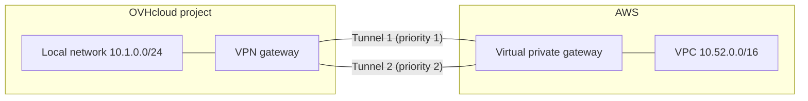

## Objective

This guide connects an OVHcloud VPN gateway to an AWS virtual private gateway with AWS Site-to-Site VPN, over two IPsec tunnels. The OVHcloud side is configured from the OVHcloud Console, the AWS side with the AWS CLI.

:::warning
Site-to-Site VPN is in alpha. The Console offers the regions of your project where it is available: BHS1.PREPROD during the alpha.
:::

**In this guide, you will learn how to:**

- connect to AWS with static routing, the two tunnels in active / standby;
- connect to AWS with BGP, one BGP session per tunnel.

## Requirements

- A Public Cloud project with access to the Site-to-Site VPN alpha, in a region where it is available (BHS1.PREPROD during the alpha). To join the alpha, contact your OVHcloud representative.
- Access to the <ManagerLink to="/beta/#/public-cloud/project">OVHcloud Console</ManagerLink>.
- A private subnet of the project in that region, for the VPN gateway, and an instance on it to test the link.
- An AWS account, the AWS CLI configured for it, and the VPC to connect (`<vpc-id>`) with its route tables (`<rtb-id>`: run the route propagation command once per route table of the VPC's subnets).
- To test the link, an instance in the VPC whose security group allows ICMP from the local network (`10.1.0.0/24` in the examples).

For the objects you create and the limits that apply to them, see [Key concepts](/guides/public-cloud/network-services/site-to-site-vpn-getting-started#concepts) and [Key limits](/guides/public-cloud/network-services/site-to-site-vpn-getting-started#key-limits).

## Instructions

This section gives the order of the steps, then one scenario per routing mode. Follow the overview, then the scenario you need.

**Contents:**

- [Overview](#overview)
- [Scenario A: static routing](#scenario-a)
- [Scenario B: BGP](#scenario-b)
- [Limitations](#limitations)
- [Troubleshooting](#troubleshooting)

### Overview <a name="overview"></a>

Both scenarios follow the same order, because each side needs a value from the other: AWS needs the public address of the VPN gateway, and the VPN gateway needs the addresses of the two AWS tunnels.



1. Create the VPN gateway and read its public address.
2. Create the AWS customer gateway, virtual private gateway and VPN connection, and read the outside addresses of its two tunnels.
3. Create the IPsec connection with its endpoint groups, security proposal and two tunnels, on the VPN gateway.
4. Route your OVHcloud instances to the VPC through the VPN gateway, from the connection's recap.

### Scenario A: static routing <a name="scenario-a"></a>

Two tunnels to an AWS virtual private gateway, statically routed: AWS routes the local networks of the VPN gateway into the VPN connection, and the VPN gateway routes the VPC into its two tunnels, active / standby.

The example uses these values:

| Value | Example |
|---|---|
| Local network (OVHcloud side) | `10.1.0.0/24` |
| VPC | `10.52.0.0/16` |
| Pre-shared keys (your own choice) | `<psk-1>`, `<psk-2>` |

#### Step 1 — Create the VPN gateway and read its public address

Create a VPN gateway as described in [Get started in the Console](/guides/public-cloud/network-services/site-to-site-vpn-getting-started#gateway), attaching it to your private subnet on `10.1.0.0/24`. Once it is ready, read its public address, `<ovhcloud-public-ip>` below, from the **Public network** card of its page.

#### Step 2 — Create the AWS side

Create the customer gateway, the virtual private gateway and a static VPN connection, with a route to the local network of the VPN gateway. Choose your own pre-shared keys now (`<psk-1>`, `<psk-2>`): you will set the same ones on the VPN gateway in Step 3.

```bash
aws ec2 create-customer-gateway --type ipsec.1 \
      --public-ip <ovhcloud-public-ip>
aws ec2 create-vpn-gateway --type ipsec.1
aws ec2 attach-vpn-gateway --vpn-gateway-id <vgw-id> --vpc-id <vpc-id>
aws ec2 create-vpn-connection --type ipsec.1 \
      --customer-gateway-id <cgw-id> --vpn-gateway-id <vgw-id> \
      --options '{"StaticRoutesOnly": true, "TunnelOptions": [
        {"PreSharedKey": "<psk-1>",
         "StartupAction": "start", "DPDTimeoutAction": "restart"},
        {"PreSharedKey": "<psk-2>",
         "StartupAction": "start", "DPDTimeoutAction": "restart"}]}'
aws ec2 create-vpn-connection-route --vpn-connection-id <vpn-id> \
      --destination-cidr-block 10.1.0.0/24
aws ec2 enable-vgw-route-propagation --route-table-id <rtb-id> \
      --gateway-id <vgw-id>   # once per route table of the VPC's subnets
aws ec2 describe-vpn-connections --vpn-connection-ids <vpn-id> \
      --query 'VpnConnections[0].State'
aws ec2 describe-vpn-connections --vpn-connection-ids <vpn-id> \
      --query 'VpnConnections[0].Options.TunnelOptions[].OutsideIpAddress'
```

Wait until the VPN connection is `available` (a few minutes) before the next step. The last command returns the outside addresses of the two AWS tunnels, `<aws-outside-ip-1>` and `<aws-outside-ip-2>` below.

#### Step 3 — Create the IPsec connection

Create the IPsec connection as described in [Get started in the Console](/guides/public-cloud/network-services/site-to-site-vpn-getting-started#connection), on the gateway you just created, with these values:

| Field | Value |
|---|---|
| Routing | **Static** |
| Local endpoint group | New, CIDR `10.1.0.0/24` (pre-filled from the gateway's subnet) |
| Remote endpoint group | New, CIDR `10.52.0.0/16` |
| Security proposal | **Recommended** (IKEv2 · AES-256 · SHA-256 · Group 14) |
| IPsec tunnels | **Two** |
| Tunnel 1 — Peer address | `<aws-outside-ip-1>` |
| Tunnel 1 — Pre-shared key | `<psk-1>`, the same key given to AWS in Step 2 |
| Tunnel 2 — Peer address | `<aws-outside-ip-2>` |
| Tunnel 2 — Pre-shared key | `<psk-2>`, the same key given to AWS in Step 2 |

AWS's IKE SA lifetime is fixed at 28800 seconds against the Recommended proposal's 10800 seconds; this does not need to match, each side rekeys independently on its own timer.

#### Step 4 — Route your instances to the VPC <a name="routes-a"></a>

The connection carries traffic only once your OVHcloud instances send the VPC's network to the VPN gateway. The recap of the new connection does it for you:

1. On the recap, read the **Route the remote networks** card: `<subnet> (10.1.0.0/24)` · `10.52.0.0/16 → <gateway private IP>`, the gateway's private IP on your subnet.
2. Click <code className="action">Add the routes</code>. A toast confirms **1 host route added.**, and the button reads **Routes added**.
3. Apply the route on your instances: they pick it up at their next DHCP lease renewal, which can take hours, or when they restart. To apply it at once, restart them, or renew the lease on each one (`sudo networkctl renew <interface>` on a Linux image that uses systemd-networkd). `ip route` then shows `10.52.0.0/16 via <gateway private IP> ... proto dhcp`.

To add or check the route later, see how to route your instances to the VPN gateway in [Get started in the Console](/guides/public-cloud/network-services/site-to-site-vpn-getting-started#routes).

#### How it behaves

- Both tunnels are established up front: AWS may report the second one `UP` a minute after the first. The VPN gateway sends on the best-priority tunnel that is up, and moves to the other one when it fails. It does not move back when the first one recovers (non-preemptive).
- AWS picks the tunnel it sends on by itself and may use the other one; the VPN gateway accepts traffic on either tunnel.
- When both tunnels are down, traffic to the VPC is dropped, never sent unencrypted.
- Detection relies on dead peer detection (DPD, `restart` by default): a dead peer is declared about 15 s after the first unanswered DPD check, which runs after 30 s of silence by default.
- Compared with [Scenario B](#scenario-b), any new network on either side means updating the routes by hand: `create-vpn-connection-route` on AWS, and a new endpoint group (so a new connection) on the VPN gateway.
- `StartupAction: start` (IKEv2 only) makes AWS initiate the tunnels and keep retrying, and `DPDTimeoutAction: restart` makes it restart them after a dead peer. Without them AWS only responds, and a tunnel whose negotiation fails (for example `AUTH_FAILED`, as while the VPN connection is still `pending`) is retried by neither side: it stays down while the connection still shows `ACTIVE`. To set them on an existing VPN connection (this restarts the tunnel), run this once per tunnel:

    ```bash
    aws ec2 modify-vpn-tunnel-options --vpn-connection-id <vpn-id> \
          --vpn-tunnel-outside-ip-address <aws-outside-ip> \
          --tunnel-options StartupAction=start,DPDTimeoutAction=restart
    ```

#### Verify scenario A

| Check | Where | Expected result |
|---|---|---|
| The AWS VPN connection is ready | `aws ec2 describe-vpn-connections --vpn-connection-ids <vpn-id> --query 'VpnConnections[0].State'` | `available` |
| The VPN gateway has its public address | Gateway page, **Public network** card | **Public IPv4** shows an address |
| The connection and tunnels exist | Connection page | One connection, two tunnel tiles with the AWS outside addresses as **Peer address** |
| The subnet routes the VPC | Subnet page, **Host routes** card | `10.52.0.0/16` with the gateway's private IP as **Next hop** |
| The tunnels are up on the AWS side | `aws ec2 describe-vpn-connections --vpn-connection-ids <vpn-id> --query 'VpnConnections[0].VgwTelemetry[].[OutsideIpAddress,Status]'` | Both tunnels `UP` |
| An OVHcloud instance has the route | On the instance, `ip route show 10.52.0.0/16` | `10.52.0.0/16 via <gateway private IP>` |
| Traffic goes through the tunnel | On the OVHcloud instance, `ping <AWS instance private IP>`, and the reverse from the AWS instance | Replies in both directions |

:::info
The Console shows no tunnel status: it does not tell whether a tunnel is up. Check it on the AWS side, then with a ping between instances.
:::

### Scenario B: BGP <a name="scenario-b"></a>

Two tunnels to an AWS virtual private gateway, one BGP session each.

The example uses these values:

| Value | Example |
|---|---|
| Local network (OVHcloud side) | `10.1.0.0/24` |
| VPC | `10.52.0.0/16` |
| ASN of the VPN gateway | `65000` |
| ASN of AWS | `64512` |
| Tunnel inside networks (your own choice) | `169.254.10.0/30` and `169.254.11.0/30` |
| Inside addresses | AWS on `.1`, the VPN gateway on `.2` |
| Pre-shared keys (your own choice) | `<psk-1>`, `<psk-2>` |

#### Step 1 — Create the VPN gateway and read its public address

Create a VPN gateway as described in [Get started in the Console](/guides/public-cloud/network-services/site-to-site-vpn-getting-started#gateway), attaching it to your private subnet on `10.1.0.0/24`. Once it is ready, read its public address, `<ovhcloud-public-ip>` below, from the **Public network** card of its page.

#### Step 2 — Create the AWS side

Create the customer gateway, the virtual private gateway and the VPN connection, choosing the tunnel inside networks and pre-shared keys you will reuse on the VPN gateway:

```bash
aws ec2 create-customer-gateway --type ipsec.1 \
      --public-ip <ovhcloud-public-ip> --bgp-asn 65000
aws ec2 create-vpn-gateway --type ipsec.1 --amazon-side-asn 64512
aws ec2 attach-vpn-gateway --vpn-gateway-id <vgw-id> --vpc-id <vpc-id>
aws ec2 create-vpn-connection --type ipsec.1 \
      --customer-gateway-id <cgw-id> --vpn-gateway-id <vgw-id> \
      --options '{"StaticRoutesOnly": false, "TunnelOptions": [
        {"TunnelInsideCidr": "169.254.10.0/30", "PreSharedKey": "<psk-1>",
         "StartupAction": "start", "DPDTimeoutAction": "restart"},
        {"TunnelInsideCidr": "169.254.11.0/30", "PreSharedKey": "<psk-2>",
         "StartupAction": "start", "DPDTimeoutAction": "restart"}]}'
aws ec2 enable-vgw-route-propagation --route-table-id <rtb-id> \
      --gateway-id <vgw-id>   # once per route table of the VPC's subnets
```

Wait until the VPN connection is `available` (a few minutes) before the next step, and note the outside addresses of its two tunnels:

```bash
aws ec2 describe-vpn-connections --vpn-connection-ids <vpn-id> \
      --query 'VpnConnections[0].State'
aws ec2 describe-vpn-connections --vpn-connection-ids <vpn-id> \
      --query 'VpnConnections[0].Options.TunnelOptions[].OutsideIpAddress'
```

#### Step 3 — Create the IPsec connection

Create the IPsec connection as described in [Get started in the Console](/guides/public-cloud/network-services/site-to-site-vpn-getting-started#connection), on the gateway you just created, with these values:

| Field | Value |
|---|---|
| Routing | **BGP** |
| Local ASN | `65000` |
| Peer ASN | `64512` |
| Local endpoint group | New, CIDR `10.1.0.0/24` (pre-filled from the gateway's subnet) |
| Remote endpoint group | New, CIDR `10.52.0.0/16` |
| Security proposal | **Recommended** (IKEv2 · AES-256 · SHA-256 · Group 14) |
| IPsec tunnels | **Two** |
| Tunnel 1 — Peer address | `<aws-outside-ip-1>` |
| Tunnel 1 — Pre-shared key | `<psk-1>`, the same key given to AWS in Step 2 |
| Tunnel 1 — BGP tunnel address | `169.254.10.2/30` (enter it: do not use the pre-filled suggestion, it must match AWS) |
| Tunnel 1 — BGP peer address | `169.254.10.1` |
| Tunnel 2 — Peer address | `<aws-outside-ip-2>` |
| Tunnel 2 — Pre-shared key | `<psk-2>`, the same key given to AWS in Step 2 |
| Tunnel 2 — BGP tunnel address | `169.254.11.2/30` |
| Tunnel 2 — BGP peer address | `169.254.11.1` |

AWS's IKE SA lifetime is fixed at 28800 seconds against the Recommended proposal's 10800 seconds; this does not need to match, each side rekeys independently on its own timer. With a transit gateway and VPN ECMP enabled, also turn on the **Inbound ECMP** switch so that AWS uses both tunnels; with a virtual private gateway, leave it off.

#### Step 4 — Route your instances to the VPC <a name="routes-b"></a>

The connection carries traffic only once your OVHcloud instances send the VPC's network to the VPN gateway. The recap of the new connection does it for you:

1. On the recap, read the **Route the remote networks** card: `<subnet> (10.1.0.0/24)` · `10.52.0.0/16 → <gateway private IP>`, the gateway's private IP on your subnet.
2. Click <code className="action">Add the routes</code>. A toast confirms **1 host route added.**, and the button reads **Routes added**.
3. Apply the route on your instances: they pick it up at their next DHCP lease renewal, which can take hours, or when they restart. To apply it at once, restart them, or renew the lease on each one (`sudo networkctl renew <interface>` on a Linux image that uses systemd-networkd). `ip route` then shows `10.52.0.0/16 via <gateway private IP> ... proto dhcp`.

To add or check the route later, see how to route your instances to the VPN gateway in [Get started in the Console](/guides/public-cloud/network-services/site-to-site-vpn-getting-started#routes).

#### Notes

- The remote endpoint group is an envelope: routes learned outside it are ignored, so it must cover every VPC CIDR AWS advertises.
- All the networks and tunnels of a connection must be of one address family.
- `StartupAction: start` (IKEv2 only) makes AWS initiate the tunnels and keep retrying, and `DPDTimeoutAction: restart` makes it restart them after a dead peer. Without them AWS only responds, and a tunnel whose negotiation fails (for example `AUTH_FAILED`, as while the VPN connection is still `pending`) is retried by neither side: it stays down while the connection still shows `ACTIVE`. To set them on an existing VPN connection (this restarts the tunnel), run this once per tunnel:

    ```bash
    aws ec2 modify-vpn-tunnel-options --vpn-connection-id <vpn-id> \
          --vpn-tunnel-outside-ip-address <aws-outside-ip> \
          --tunnel-options StartupAction=start,DPDTimeoutAction=restart
    ```

#### Verify scenario B

| Check | Where | Expected result |
|---|---|---|
| The AWS VPN connection is ready | `aws ec2 describe-vpn-connections --vpn-connection-ids <vpn-id> --query 'VpnConnections[0].State'` | `available` |
| The VPN gateway has its public address | Gateway page, **Public network** card | **Public IPv4** shows an address |
| The connection and tunnels exist | Connection page | One connection, two tunnel tiles with the AWS outside addresses as **Peer address** |
| The subnet routes the VPC | Subnet page, **Host routes** card | `10.52.0.0/16` with the gateway's private IP as **Next hop** |
| The tunnels are up on the AWS side | `aws ec2 describe-vpn-connections --vpn-connection-ids <vpn-id> --query 'VpnConnections[0].VgwTelemetry[].[OutsideIpAddress,Status]'` | Both tunnels `UP` |
| An OVHcloud instance has the route | On the instance, `ip route show 10.52.0.0/16` | `10.52.0.0/16 via <gateway private IP>` |
| Traffic goes through the tunnel | On the OVHcloud instance, `ping <AWS instance private IP>`, and the reverse from the AWS instance | Replies in both directions |

:::info
The Console shows no tunnel status: it does not tell whether a tunnel is up. Check it on the AWS side, then with a ping between instances.
:::

### Limitations <a name="limitations"></a>

The following rules apply to both scenarios.

| Limitation | Details |
|---|---|
| Tunnels per connection | A connection holds at most two tunnels. |
| Peer networks | They may not be a default route, nor contain the address of a peer. |
| Changes while busy | While the VPN gateway is being created, updated or deleted, creating, updating or deleting its connection or tunnels is refused: retry once it is ready. |

### Troubleshooting <a name="troubleshooting"></a>

This table lists the most common cases.

| Issue | Possible cause | Solution |
|---|---|---|
| A tunnel stays down while its connection shows active | AWS only responds, and the first negotiation failed (for example `AUTH_FAILED` while the AWS VPN connection was still `pending`) | Set `StartupAction=start,DPDTimeoutAction=restart` on the tunnel with `aws ec2 modify-vpn-tunnel-options` |
| The tunnels are up but instances cannot reach the VPC | The subnet has no host route to the VPC, or the instances have not picked it up yet | Click <code className="action">Add the routes</code> on the connection's recap, or add the route from the subnet's page. Then restart the instances or renew their DHCP lease |
| AWS instances cannot reach the OVHcloud instances | The VPC route tables do not propagate the virtual private gateway's routes, or the security group refuses the traffic | Run `enable-vgw-route-propagation` for each route table of the VPC's subnets, and allow the local network in the security group |
| The Console refuses to create the connection | The VPN gateway has no active public address of the peer's family yet | Wait until the gateway's **Public network** card shows the address, then retry |
| (BGP) Routes of the VPC are missing on the OVHcloud side | The routes are outside the remote endpoint group, which ignores them | Make the remote endpoint group cover every VPC CIDR AWS advertises |

## Go further

- [Site-to-Site VPN - Get started in the Console](/guides/public-cloud/network-services/site-to-site-vpn-getting-started)
- [Creating a private network with Gateway](/guides/public-cloud/network-services/create-private-network-gateway)

Join our [community of users](/links/community).
