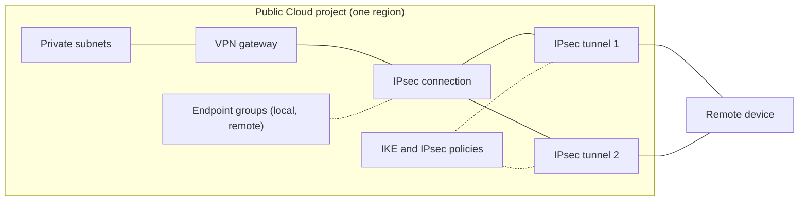

## Objective

This guide takes you from an empty Public Cloud project to a configured IPsec connection: the objects Site-to-Site VPN uses, the limits that apply to them, and the Console steps to create a VPN gateway, then an IPsec connection with its endpoint groups, its security proposal and one or two IPsec tunnels, and read the values to set on the remote device.

:::warning
Site-to-Site VPN is in **alpha**. The Console offers the regions of your project where Site-to-Site VPN is available (**BHS1.PREPROD** during the alpha), and Site-to-Site VPN is free. Screens and behaviour may change before general availability.
:::

**In this guide, you will learn how to:**

- Understand the objects Site-to-Site VPN creates and the limits that apply to them.
- Open Site-to-Site VPN in a Public Cloud project.
- Create a VPN gateway attached to your private networks and to the public network.
- Create an IPsec connection to a remote site with the creation page.
- Route your instances to the VPN gateway, so they reach the remote networks, and check what was created.

## Requirements

- A Public Cloud project in your OVHcloud account.
- Access to the <ManagerLink to="/beta/#/public-cloud/project">OVHcloud Console</ManagerLink>.
- Site-to-Site VPN enabled on the project. Without it, the **Site-to-Site VPN** entry is not shown in the menu, and the Site-to-Site VPN pages redirect to the project's dashboard. To join the alpha, contact your OVHcloud representative.
- A private network with at least one subnet in a region where Site-to-Site VPN is available (BHS1.PREPROD during the alpha).
- A remote device (an on-premises router, a firewall or another cloud's VPN gateway) with a public IPv4 or IPv6 address, which you can configure.

## Key concepts 

Site-to-Site VPN connects the private networks of your Public Cloud project to a remote site through IPsec tunnels. The OVHcloud end of the tunnels is a **VPN gateway**: a router dedicated to IPsec, attached to your private subnets on one side and to the public network on the other, in one region fixed at creation. The remote end is your own device: a firewall or router on premises, or the VPN service of another cloud provider.

- **Endpoint group**: a named list of CIDRs in one region — an IPsec connection's **local** (OVHcloud side) or **remote** (the remote site's) networks. Several connections can share one.
- **IKE policy** and **IPsec policy**: the phase 1 and phase 2 algorithms (encryption, integrity, Diffie-Hellman group, lifetime) a tunnel negotiates. Configure the same algorithms on the remote device. Policies are shared objects: several tunnels can use the same pair.
- **IPsec connection**: describes one remote site — the gateway it runs on, its routing mode (static or BGP) and its two endpoint groups. These are fixed once the connection exists; only its name and description can change. A VPN gateway holds one IPsec connection.
- **IPsec tunnel**: carries the per-tunnel settings — the peer's public address, the pre-shared key, the IKE and IPsec policies, dead peer detection, MTU. A connection holds up to two tunnels; the lowest-**priority** one is preferred, giving a standby path.
- **Pre-shared key (PSK)**: tunnels authenticate with a PSK only — certificate authentication is not supported. It is 8 to 255 printable ASCII characters, required at creation, and write-only: the Console never shows it again, so keep your own copy.
- **Routing**: a connection is **static** (the remote endpoint group's networks are routed into the tunnels; failover between two tunnels is active/standby, non-preemptive) or **BGP** (one eBGP session per tunnel; failover follows BGP and is preemptive). In both modes, traffic to the remote networks is dropped, never sent unencrypted, when every tunnel is down.

### Key limits 

- A VPN gateway holds **one** IPsec connection, which holds **up to two** IPsec tunnels.
- The policies accept a hardened set of options: IKEv2 only, AES (CBC or GCM) with SHA-2; weaker options (IKEv1, SHA-1, 3DES, Diffie-Hellman groups 2 and 5) are refused.
- A remote network cannot be a default route (`0.0.0.0/0` or `::/0`), nor contain a tunnel's peer address.
- A BGP connection carries one address family: its networks and tunnel addresses are all IPv4, or all IPv6.
- The Console does not report whether a tunnel is currently up: the status shown is a provisioning status.

## Instructions

This section covers the whole first setup, in the order the Console expects it.

**Contents:**

- [Step 1 - Open Site-to-Site VPN](#open)
- [Step 2 - Create a VPN gateway](#gateway)
- [Step 3 - Create the IPsec connection](#connection)
- [Step 4 - Configure the remote device](#remote)
- [Step 5 - Route your instances to the VPN gateway](#routes)
- [Step 6 - Verify](#verify)

### Step 1 - Open Site-to-Site VPN 

1. Log in to the <ManagerLink to="/beta/#/public-cloud/project">OVHcloud Console</ManagerLink> and select your Public Cloud project.
2. In the project menu, open the **Network** section and click <code className="action">Site-to-Site VPN</code>. The entry carries an **Alpha** tag.

The **Site-to-Site VPN** page opens. In a project with no VPN gateway, the page shows **No VPN gateway yet** in place of the tabs, with a <code className="action">Create a VPN gateway</code> button. Once a gateway exists, the page has five tabs: <code className="action">VPN gateways</code>, <code className="action">IPsec connections</code>, <code className="action">Endpoint groups</code>, <code className="action">IKE policies</code> and <code className="action">IPsec policies</code>.

### Step 2 - Create a VPN gateway 

The VPN gateway is the first object to create: an IPsec connection always runs on a VPN gateway.

1. Click <code className="action">Create a VPN gateway</code>.
2. In **Name**, enter a name (at most 255 characters). A name already used by a VPN gateway of the project is refused. A default name of the form `vpn-gw-<ddmmyyyy>` is filled in.
3. In **Region**, select the region of the gateway. One card is shown per region of your project where Site-to-Site VPN is available (**BHS1.PREPROD** during the alpha). The region cannot be changed once the gateway exists, and its private networks are in this region.
4. In **Network configuration**, choose a **Private network** and a **Subnet** for each subnet the gateway must serve. The first subnet of the region is pre-selected. Click <code className="action">Add a subnet</code> to add a row, or the remove button of a row to drop it. The gateway takes a private IP in each subnet, and any host of these subnets can reach it. Below the rows, the page states the public connectivity: there is nothing to choose. The VPN gateway receives a public IPv4 and a public IPv6 address, kept until it is deleted, and each IPsec tunnel uses the one of its peer's family.
5. Check the summary on the right (**Region**, **Private networks**, **Public IP**), then click <code className="action">Create the VPN gateway</code>.

The Console confirms that the gateway is being created: once it is ready, create its IPsec connection from its page. The gateway cannot carry an IPsec tunnel while it is being created, nor before it has a public IP.

:::tip
A gateway created without any subnet carries no traffic until a subnet is attached. You can attach subnets later from the gateway's page, in its **Private networks** card.
:::

### Step 3 - Create the IPsec connection 

The **Create an IPsec connection** page creates, in one submission, the endpoint groups you define as new, the IKE and IPsec policies if they are needed, the IPsec connection and its tunnels.

1. Open the <code className="action">IPsec connections</code> tab and click <code className="action">Create an IPsec connection</code>. You can also open the gateway's page and click <code className="action">Create an IPsec connection</code> in its **IPsec connection** card: the gateway is then pre-selected.
2. In **IPsec connection**, enter a **Name**. A default name of the form `ipsec-connection-<ddmmyyyy>` is filled in.
3. In **VPN gateway**, select the gateway. Only gateways without an IPsec connection are listed. A gateway that cannot carry a tunnel yet is listed but cannot be selected, with its reason: **Creating — no public IP yet**, **Updating — retry once it is ready**, **Being deleted**, **Not attached to the public network** or **No public IP yet**.
4. In **Routing**, select <code className="action">Static</code> or <code className="action">BGP</code>:
    - **Static**: the remote networks go over the tunnel with the lowest priority; the other takes over when it fails.
    - **BGP**: one eBGP session per tunnel; only routes within the remote endpoint group are accepted (up to 100). Enter the **Local ASN** (pre-filled with `65000`) and the **Peer ASN**, and turn on the <code className="action">Inbound ECMP</code> switch if the remote device can balance its traffic over both tunnels. The two ASNs must differ, and each must be between 1 and 4294967295, other than 23456.
5. In **Endpoint groups**, define the **Local endpoint group** (the OVHcloud side) and the **Remote endpoint group** (the remote site's networks). For each side, select <code className="action">Existing endpoint group</code> and pick a group of the gateway's region, or <code className="action">New endpoint group</code> and enter a **Name** and its **CIDRs** (<code className="action">Add a CIDR</code> adds a row). Both sides start on a new endpoint group. A new local group is pre-filled with the CIDRs of the subnets the gateway is attached to. A remote network cannot be a default route (`/0`), and no remote CIDR may contain a tunnel's peer address. On a BGP connection, use only IPv4 or only IPv6 CIDRs.
6. In **Security proposal**, select the algorithms both tunnels negotiate:
    - The first option, marked **Recommended**: IKEv2 · AES-256 · SHA-256 · Group 14 (MODP-2048) with a lifetime of 10800 seconds for phase 1, and ESP · Tunnel · AES-256 · SHA-256 · Group 14 (MODP-2048) with a lifetime of 3600 seconds for phase 2. If the gateway's region already has an IKE and an IPsec policy with exactly these algorithms, the tunnels use them. Otherwise, `ike-aes256-sha256` and `ipsec-aes256-sha256` are created with the connection. The remote device does not need to match this lifetime: each side rekeys independently on its own timer.
    - <code className="action">Existing policies</code>: pick an **IKE policy** and an **IPsec policy** of the gateway's region, for a remote device with its own algorithms. This option is disabled while the region has no IKE and IPsec policy. To use other algorithms or a different lifetime, create the policies first from the <code className="action">IKE policies</code> and <code className="action">IPsec policies</code> tabs.
7. In **IPsec tunnels**, select <code className="action">Two (recommended)</code> or <code className="action">One</code>, then fill in each **IPsec tunnel** block:
    - **Name**: pre-filled with the default connection name followed by `-1` and `-2` (for example `ipsec-connection-10112026-1`). These names do not follow a connection name you type: change them here if you want them to match.
    - **Peer address**: the public IPv4 or IPv6 address of the remote device for this tunnel.
    - **Priority**: pre-filled with 1 and 2. The lowest is preferred.
    - **Pre-shared key**: 8 to 255 printable ASCII characters. It is write-only: the Console never shows it again, so keep your own copy.
    - On a BGP connection, **BGP tunnel address** and **BGP peer address**: when you select BGP, empty fields are pre-filled with free `/30` networks of `169.254.0.0/16` (`169.254.10.1/30` and `169.254.10.2`, then `169.254.10.5/30` and `169.254.10.6`, when nothing else uses them). The remote device must use the same addresses.
8. Check the summary on the right, then click <code className="action">Create the IPsec connection</code>. The button stays disabled until every step is valid.

Peer ID, Local ID, dead peer detection, MTU and initiator take their defaults. You can change them later from each tunnel's page.

If the submission fails part-way, an error toast **Unable to create the IPsec connection** names the step that failed, the API's reason and what was already created and kept. The page stays open with what you entered, so you can fix it and submit again.

### Step 4 - Configure the remote device 

Once the connection is submitted, the page turns into a recap. It shows a **Route the remote networks** card (see [Step 5](#routes)), then one card per tunnel: **Remote peer (our public IP)**, **Their networks**, **Our networks**, **IKE (phase 1)**, **IPsec (phase 2)** and, on a BGP connection, **BGP**.

1. Configure these values on the remote device, with the pre-shared key you typed for each tunnel. The pre-shared key is write-only: the API never returns it.
2. Add the host routes, as described in [Step 5](#routes), before you leave the recap.
3. Click <code className="action">Finish</code>.

To read the same values later, open the connection's page and click <code className="action">Copy the remote device configuration</code> on a tunnel. For the settings each provider expects, see the guides listed in [Go further](#go-further).

### Step 5 - Route your instances to the VPN gateway 

Your instances reach the remote networks through the VPN gateway once their subnet routes them there: each subnet of the gateway needs a **host route** per remote network, whose next hop is the gateway's private IP on that subnet. The subnet's DHCP hands these routes to every instance of the subnet.

1. On the recap of the new connection, read the **Route the remote networks** card. It lists, for each subnet of the gateway, the route its instances need: `<subnet> (<cidr>)` · `<remote network> → <gateway's private IP on that subnet>`, one per remote network of the connection's address family. A subnet whose private IP is not known yet is left out.
2. Click <code className="action">Add the routes</code>. The routes are added after each subnet's existing host routes. A destination a subnet already routes, through this gateway or elsewhere, is left as it is, never overwritten. A toast confirms how many routes were added, and the button then reads **Routes added**.
3. Apply the routes on the instances, as described below.

You can also add or change a subnet's routes later: open the gateway's page and, in the **Private networks** card, click <code className="action">Host routes</code> on the subnet's row. The subnet's page opens with its **Add a route** drawer, the gateway's private IP filled in as **Next hop**: enter the remote network as **Destination**, then click <code className="action">Add a route</code>. A subnet's routes are listed, added and deleted on its page.

:::warning
Instances pick up new host routes at their next DHCP lease renewal, which can take hours, or when they restart. Until then, they do not send traffic to the remote networks through the VPN gateway.
:::

To apply the routes at once, restart the instances, or renew their DHCP lease from inside each instance. On a Linux image that uses systemd-networkd, such as Debian or Ubuntu, run `sudo networkctl renew <interface>`. The route then shows in `ip route`, for example `10.42.0.0/16 via 10.1.0.221 dev ens3 proto dhcp`.

### Step 6 - Verify 

Check the objects in the Console.

| Check | Where | Expected |
|---|---|---|
| The gateway has its public address | Gateway page, **Public network** card | **Public IPv4** (and **Public IPv6**) show an address |
| The gateway is on its subnets | Gateway page, **Private networks** card | One row per subnet, with its **Private IP** |
| The connection exists | <code className="action">IPsec connections</code> tab | One row, with its **VPN gateway**, **Routing** and **IPsec tunnels** count |
| The tunnels exist | Connection page, **IPsec tunnels** section | One tile per tunnel, sorted by priority |
| The subnet routes the remote networks | Subnet page, **Host routes** card | One row per remote network, with the gateway's private IP as **Next hop** |
| An instance has the route | On the instance, `ip route` | One line per remote network, `via` the gateway's private IP |

:::info
The Console shows no tunnel status: it does not tell whether a tunnel is up. Check the tunnel on the remote device, then send traffic between an instance and a host of the remote network, for example with `ping`.
:::

## Go further 

- [Site-to-Site VPN - Connect to AWS](/guides/public-cloud/network-services/site-to-site-vpn-connect-aws)
- [Creating a private network with Gateway](/guides/public-cloud/network-services/create-private-network-gateway)
- [Update a subnet properties](/guides/public-cloud/network-services/update-subnet-properties)

Join our [community of users](/links/community).
