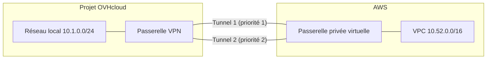

## Objectif

Ce guide relie une passerelle VPN OVHcloud à une passerelle privée virtuelle AWS (virtual private gateway) avec AWS Site-to-Site VPN, par deux tunnels IPsec. Le côté OVHcloud se configure depuis la Console OVHcloud, le côté AWS avec l'AWS CLI.

:::warning
Le VPN Site-to-Site est en alpha. La Console propose les régions de votre projet où il est disponible : BHS1.PREPROD pendant l'alpha.
:::

**Dans ce guide, vous apprendrez à :**

- vous connecter à AWS en routage statique, les deux tunnels en actif / secours ;
- vous connecter à AWS en BGP, avec une session BGP par tunnel.

## Prérequis

- Un projet Public Cloud ayant accès à l'alpha du VPN Site-to-Site, dans une région où il est disponible (BHS1.PREPROD pendant l'alpha). Pour rejoindre l'alpha, contactez votre interlocuteur OVHcloud.
- Un accès à la <ManagerLink to="/beta/#/public-cloud/project">Console OVHcloud</ManagerLink>.
- Un sous-réseau privé du projet dans cette région, pour la passerelle VPN, et une instance sur ce sous-réseau pour tester la liaison.
- Un compte AWS, l'AWS CLI configurée pour ce compte, et le VPC à relier (`<vpc-id>`) avec ses tables de routage (`<rtb-id>` : exécutez la commande de propagation de routes une fois par table de routage des sous-réseaux du VPC).
- Pour tester la liaison, une instance dans le VPC dont le groupe de sécurité autorise l'ICMP depuis le réseau local (`10.1.0.0/24` dans les exemples).

Pour les objets que vous créez et les limites qui s'y appliquent, consultez les [concepts clés](/guides/public-cloud/network-services/site-to-site-vpn-getting-started#concepts) et les [limites clés](/guides/public-cloud/network-services/site-to-site-vpn-getting-started#key-limits).

## En pratique

Cette section donne l'ordre des étapes, puis un scénario par mode de routage. Suivez la vue d'ensemble, puis le scénario dont vous avez besoin.

**Sommaire :**

- [Vue d'ensemble](#overview)
- [Scénario A : routage statique](#scenario-a)
- [Scénario B : BGP](#scenario-b)
- [Limites](#limitations)
- [Dépannage](#troubleshooting)

### Vue d'ensemble <a name="overview"></a>

Les deux scénarios suivent le même ordre, car chaque côté a besoin d'une valeur de l'autre : AWS a besoin de l'adresse publique de la passerelle VPN, et la passerelle VPN a besoin des adresses des deux tunnels AWS.



1. Créez la passerelle VPN et lisez son adresse publique.
2. Créez la passerelle client (customer gateway), la passerelle privée virtuelle et la connexion VPN AWS, et lisez les adresses extérieures de ses deux tunnels.
3. Créez la connexion IPsec avec ses groupes de points de terminaison, sa proposition de sécurité et ses deux tunnels, sur la passerelle VPN.
4. Routez vos instances OVHcloud vers le VPC par la passerelle VPN, depuis le récapitulatif de la connexion.

### Scénario A : routage statique <a name="scenario-a"></a>

Deux tunnels vers une passerelle privée virtuelle AWS, en routage statique : AWS route les réseaux locaux de la passerelle VPN dans la connexion VPN, et la passerelle VPN route le VPC dans ses deux tunnels, en actif / secours.

L'exemple utilise ces valeurs :

| Valeur | Exemple |
|---|---|
| Réseau local (côté OVHcloud) | `10.1.0.0/24` |
| VPC | `10.52.0.0/16` |
| Clés pré-partagées (à votre choix) | `<psk-1>`, `<psk-2>` |

#### Étape 1 — Créer la passerelle VPN et lire son adresse publique

Créez une passerelle VPN comme décrit dans [Premiers pas dans la Console](/guides/public-cloud/network-services/site-to-site-vpn-getting-started#gateway), en l'attachant à votre sous-réseau privé `10.1.0.0/24`. Une fois prête, lisez son adresse publique, `<ovhcloud-public-ip>` ci-dessous, dans la carte **Réseau public** de sa page.

#### Étape 2 — Créer le côté AWS

Créez la passerelle client, la passerelle privée virtuelle et une connexion VPN statique, avec une route vers le réseau local de la passerelle VPN. Choisissez dès maintenant vos clés pré-partagées (`<psk-1>`, `<psk-2>`) : vous réglerez les mêmes sur la passerelle VPN à l'étape 3.

```bash
aws ec2 create-customer-gateway --type ipsec.1 \
      --public-ip <ovhcloud-public-ip>
aws ec2 create-vpn-gateway --type ipsec.1
aws ec2 attach-vpn-gateway --vpn-gateway-id <vgw-id> --vpc-id <vpc-id>
aws ec2 create-vpn-connection --type ipsec.1 \
      --customer-gateway-id <cgw-id> --vpn-gateway-id <vgw-id> \
      --options '{"StaticRoutesOnly": true, "TunnelOptions": [
        {"PreSharedKey": "<psk-1>",
         "StartupAction": "start", "DPDTimeoutAction": "restart"},
        {"PreSharedKey": "<psk-2>",
         "StartupAction": "start", "DPDTimeoutAction": "restart"}]}'
aws ec2 create-vpn-connection-route --vpn-connection-id <vpn-id> \
      --destination-cidr-block 10.1.0.0/24
aws ec2 enable-vgw-route-propagation --route-table-id <rtb-id> \
      --gateway-id <vgw-id>   # une fois par table de routage des sous-réseaux du VPC
aws ec2 describe-vpn-connections --vpn-connection-ids <vpn-id> \
      --query 'VpnConnections[0].State'
aws ec2 describe-vpn-connections --vpn-connection-ids <vpn-id> \
      --query 'VpnConnections[0].Options.TunnelOptions[].OutsideIpAddress'
```

Attendez que la connexion VPN soit `available` (quelques minutes) avant l'étape suivante. La dernière commande renvoie les adresses extérieures des deux tunnels AWS, `<aws-outside-ip-1>` et `<aws-outside-ip-2>` ci-dessous.

#### Étape 3 — Créer la connexion IPsec

Créez la connexion IPsec comme décrit dans [Premiers pas dans la Console](/guides/public-cloud/network-services/site-to-site-vpn-getting-started#connection), sur la passerelle que vous venez de créer, avec ces valeurs :

| Champ | Valeur |
|---|---|
| Routage | **Statique** |
| Groupe local | Nouveau, CIDR `10.1.0.0/24` (prérempli depuis le sous-réseau de la passerelle) |
| Groupe distant | Nouveau, CIDR `10.52.0.0/16` |
| Proposition de sécurité | **Recommandée** (IKEv2 · AES-256 · SHA-256 · Groupe 14) |
| Tunnels IPsec | **Deux** |
| Tunnel 1 — Adresse du pair | `<aws-outside-ip-1>` |
| Tunnel 1 — Clé pré-partagée | `<psk-1>`, la même clé que celle donnée à AWS à l'étape 2 |
| Tunnel 2 — Adresse du pair | `<aws-outside-ip-2>` |
| Tunnel 2 — Clé pré-partagée | `<psk-2>`, la même clé que celle donnée à AWS à l'étape 2 |

La durée de vie de la SA IKE d'AWS est fixée à 28800 secondes, contre 10800 secondes pour la proposition recommandée ; elles n'ont pas besoin de correspondre, chaque côté renégocie les clés selon son propre minuteur.

#### Étape 4 — Router vos instances vers le VPC <a name="routes-a"></a>

La connexion ne transporte du trafic qu'une fois que vos instances OVHcloud envoient le réseau du VPC vers la passerelle VPN. Le récapitulatif de la nouvelle connexion le fait pour vous :

1. Sur le récapitulatif, lisez la carte **Router les réseaux distants** : `<sous-réseau> (10.1.0.0/24)` · `10.52.0.0/16 → <IP privée de la passerelle>`, l'IP privée de la passerelle sur votre sous-réseau.
2. Cliquez sur <code className="action">Ajouter les routes</code>. Une notification confirme **1 route d'hôte ajoutée.**, et le bouton affiche **Routes ajoutées**.
3. Appliquez la route sur vos instances : elles la prennent en compte au prochain renouvellement de leur bail DHCP, qui peut prendre plusieurs heures, ou à leur redémarrage. Pour l'appliquer tout de suite, redémarrez-les, ou renouvelez le bail sur chacune (`sudo networkctl renew <interface>` sur une image Linux qui utilise systemd-networkd). `ip route` affiche alors `10.52.0.0/16 via <IP privée de la passerelle> ... proto dhcp`.

Pour ajouter ou vérifier la route plus tard, voyez comment router vos instances vers la passerelle VPN dans [Premiers pas dans la Console](/guides/public-cloud/network-services/site-to-site-vpn-getting-started#routes).

#### Fonctionnement

- Les deux tunnels sont établis d'emblée : AWS peut signaler le second `UP` une minute après le premier. La passerelle VPN émet sur le tunnel établi de meilleure priorité, et passe sur l'autre en cas de panne. Elle ne revient pas sur le premier quand il se rétablit (non préemptif).
- AWS choisit lui-même le tunnel sur lequel il émet et peut utiliser l'autre ; la passerelle VPN accepte le trafic sur les deux tunnels.
- Quand les deux tunnels sont tombés, le trafic vers le VPC est abandonné, jamais envoyé en clair.
- La détection repose sur la détection de pair mort (DPD, `restart` par défaut) : un pair est déclaré mort environ 15 s après le premier contrôle DPD sans réponse, lancé après 30 s de silence par défaut.
- Par rapport au [scénario B](#scenario-b), tout nouveau réseau d'un côté ou de l'autre impose de mettre à jour les routes à la main : `create-vpn-connection-route` côté AWS, et un nouveau groupe de points de terminaison (donc une nouvelle connexion) sur la passerelle VPN.
- `StartupAction: start` (IKEv2 uniquement) fait initier les tunnels par AWS et le fait réessayer, et `DPDTimeoutAction: restart` lui fait redémarrer les tunnels après un pair mort. Sans eux, AWS se contente de répondre, et un tunnel dont la négociation échoue (par exemple `AUTH_FAILED`, tant que la connexion VPN est encore `pending`) n'est relancé par aucun des deux côtés : il reste tombé alors que la connexion affiche toujours `ACTIVE`. Pour les régler sur une connexion VPN existante (cela redémarre le tunnel), exécutez ceci une fois par tunnel :

    ```bash
    aws ec2 modify-vpn-tunnel-options --vpn-connection-id <vpn-id> \
          --vpn-tunnel-outside-ip-address <aws-outside-ip> \
          --tunnel-options StartupAction=start,DPDTimeoutAction=restart
    ```

#### Vérifier le scénario A

| Vérification | Où | Résultat attendu |
|---|---|---|
| La connexion VPN AWS est prête | `aws ec2 describe-vpn-connections --vpn-connection-ids <vpn-id> --query 'VpnConnections[0].State'` | `available` |
| La passerelle VPN a son adresse publique | Page de la passerelle, carte **Réseau public** | **IPv4 publique** affiche une adresse |
| La connexion et les tunnels existent | Page de la connexion | Une connexion, deux tuiles de tunnel avec les adresses extérieures AWS comme **Adresse du pair** |
| Le sous-réseau route le VPC | Page du sous-réseau, carte **Routes d'hôte** | `10.52.0.0/16` avec l'IP privée de la passerelle comme **Prochain saut** |
| Les tunnels sont établis côté AWS | `aws ec2 describe-vpn-connections --vpn-connection-ids <vpn-id> --query 'VpnConnections[0].VgwTelemetry[].[OutsideIpAddress,Status]'` | Les deux tunnels `UP` |
| Une instance OVHcloud a la route | Sur l'instance, `ip route show 10.52.0.0/16` | `10.52.0.0/16 via <IP privée de la passerelle>` |
| Le trafic passe par le tunnel | Sur l'instance OVHcloud, `ping <IP privée de l'instance AWS>`, et l'inverse depuis l'instance AWS | Des réponses dans les deux sens |

:::info
La Console n'affiche pas l'état des tunnels : elle n'indique pas si un tunnel est établi. Vérifiez-le côté AWS, puis avec un ping entre les instances.
:::

### Scénario B : BGP <a name="scenario-b"></a>

Deux tunnels vers une passerelle privée virtuelle AWS, avec une session BGP chacun.

L'exemple utilise ces valeurs :

| Valeur | Exemple |
|---|---|
| Réseau local (côté OVHcloud) | `10.1.0.0/24` |
| VPC | `10.52.0.0/16` |
| ASN de la passerelle VPN | `65000` |
| ASN d'AWS | `64512` |
| Réseaux internes des tunnels (à votre choix) | `169.254.10.0/30` et `169.254.11.0/30` |
| Adresses internes | AWS en `.1`, la passerelle VPN en `.2` |
| Clés pré-partagées (à votre choix) | `<psk-1>`, `<psk-2>` |

#### Étape 1 — Créer la passerelle VPN et lire son adresse publique

Créez une passerelle VPN comme décrit dans [Premiers pas dans la Console](/guides/public-cloud/network-services/site-to-site-vpn-getting-started#gateway), en l'attachant à votre sous-réseau privé `10.1.0.0/24`. Une fois prête, lisez son adresse publique, `<ovhcloud-public-ip>` ci-dessous, dans la carte **Réseau public** de sa page.

#### Étape 2 — Créer le côté AWS

Créez la passerelle client, la passerelle privée virtuelle et la connexion VPN, en choisissant les réseaux internes des tunnels et les clés pré-partagées que vous reprendrez sur la passerelle VPN :

```bash
aws ec2 create-customer-gateway --type ipsec.1 \
      --public-ip <ovhcloud-public-ip> --bgp-asn 65000
aws ec2 create-vpn-gateway --type ipsec.1 --amazon-side-asn 64512
aws ec2 attach-vpn-gateway --vpn-gateway-id <vgw-id> --vpc-id <vpc-id>
aws ec2 create-vpn-connection --type ipsec.1 \
      --customer-gateway-id <cgw-id> --vpn-gateway-id <vgw-id> \
      --options '{"StaticRoutesOnly": false, "TunnelOptions": [
        {"TunnelInsideCidr": "169.254.10.0/30", "PreSharedKey": "<psk-1>",
         "StartupAction": "start", "DPDTimeoutAction": "restart"},
        {"TunnelInsideCidr": "169.254.11.0/30", "PreSharedKey": "<psk-2>",
         "StartupAction": "start", "DPDTimeoutAction": "restart"}]}'
aws ec2 enable-vgw-route-propagation --route-table-id <rtb-id> \
      --gateway-id <vgw-id>   # une fois par table de routage des sous-réseaux du VPC
```

Attendez que la connexion VPN soit `available` (quelques minutes) avant l'étape suivante, et notez les adresses extérieures de ses deux tunnels :

```bash
aws ec2 describe-vpn-connections --vpn-connection-ids <vpn-id> \
      --query 'VpnConnections[0].State'
aws ec2 describe-vpn-connections --vpn-connection-ids <vpn-id> \
      --query 'VpnConnections[0].Options.TunnelOptions[].OutsideIpAddress'
```

#### Étape 3 — Créer la connexion IPsec

Créez la connexion IPsec comme décrit dans [Premiers pas dans la Console](/guides/public-cloud/network-services/site-to-site-vpn-getting-started#connection), sur la passerelle que vous venez de créer, avec ces valeurs :

| Champ | Valeur |
|---|---|
| Routage | **BGP** |
| ASN local | `65000` |
| ASN du pair | `64512` |
| Groupe local | Nouveau, CIDR `10.1.0.0/24` (prérempli depuis le sous-réseau de la passerelle) |
| Groupe distant | Nouveau, CIDR `10.52.0.0/16` |
| Proposition de sécurité | **Recommandée** (IKEv2 · AES-256 · SHA-256 · Groupe 14) |
| Tunnels IPsec | **Deux** |
| Tunnel 1 — Adresse du pair | `<aws-outside-ip-1>` |
| Tunnel 1 — Clé pré-partagée | `<psk-1>`, la même clé que celle donnée à AWS à l'étape 2 |
| Tunnel 1 — Adresse de tunnel BGP | `169.254.10.2/30` (saisissez-la : n'utilisez pas la suggestion préremplie, elle doit correspondre à AWS) |
| Tunnel 1 — Adresse du pair BGP | `169.254.10.1` |
| Tunnel 2 — Adresse du pair | `<aws-outside-ip-2>` |
| Tunnel 2 — Clé pré-partagée | `<psk-2>`, la même clé que celle donnée à AWS à l'étape 2 |
| Tunnel 2 — Adresse de tunnel BGP | `169.254.11.2/30` |
| Tunnel 2 — Adresse du pair BGP | `169.254.11.1` |

La durée de vie de la SA IKE d'AWS est fixée à 28800 secondes, contre 10800 secondes pour la proposition recommandée ; elles n'ont pas besoin de correspondre, chaque côté renégocie les clés selon son propre minuteur. Avec une passerelle de transit (transit gateway) et l'ECMP VPN activé, activez aussi **ECMP entrant** pour qu'AWS utilise les deux tunnels ; avec une passerelle privée virtuelle, laissez-le désactivé.

#### Étape 4 — Router vos instances vers le VPC <a name="routes-b"></a>

La connexion ne transporte du trafic qu'une fois que vos instances OVHcloud envoient le réseau du VPC vers la passerelle VPN. Le récapitulatif de la nouvelle connexion le fait pour vous :

1. Sur le récapitulatif, lisez la carte **Router les réseaux distants** : `<sous-réseau> (10.1.0.0/24)` · `10.52.0.0/16 → <IP privée de la passerelle>`, l'IP privée de la passerelle sur votre sous-réseau.
2. Cliquez sur <code className="action">Ajouter les routes</code>. Une notification confirme **1 route d'hôte ajoutée.**, et le bouton affiche **Routes ajoutées**.
3. Appliquez la route sur vos instances : elles la prennent en compte au prochain renouvellement de leur bail DHCP, qui peut prendre plusieurs heures, ou à leur redémarrage. Pour l'appliquer tout de suite, redémarrez-les, ou renouvelez le bail sur chacune (`sudo networkctl renew <interface>` sur une image Linux qui utilise systemd-networkd). `ip route` affiche alors `10.52.0.0/16 via <IP privée de la passerelle> ... proto dhcp`.

Pour ajouter ou vérifier la route plus tard, voyez comment router vos instances vers la passerelle VPN dans [Premiers pas dans la Console](/guides/public-cloud/network-services/site-to-site-vpn-getting-started#routes).

#### Remarques

- Le groupe distant sert d'enveloppe : les routes apprises en dehors sont ignorées, il doit donc couvrir chaque CIDR du VPC qu'annonce AWS.
- Tous les réseaux et tunnels d'une connexion doivent être d'une même famille d'adresses.
- `StartupAction: start` (IKEv2 uniquement) fait initier les tunnels par AWS et le fait réessayer, et `DPDTimeoutAction: restart` lui fait redémarrer les tunnels après un pair mort. Sans eux, AWS se contente de répondre, et un tunnel dont la négociation échoue (par exemple `AUTH_FAILED`, tant que la connexion VPN est encore `pending`) n'est relancé par aucun des deux côtés : il reste tombé alors que la connexion affiche toujours `ACTIVE`. Pour les régler sur une connexion VPN existante (cela redémarre le tunnel), exécutez ceci une fois par tunnel :

    ```bash
    aws ec2 modify-vpn-tunnel-options --vpn-connection-id <vpn-id> \
          --vpn-tunnel-outside-ip-address <aws-outside-ip> \
          --tunnel-options StartupAction=start,DPDTimeoutAction=restart
    ```

#### Vérifier le scénario B

| Vérification | Où | Résultat attendu |
|---|---|---|
| La connexion VPN AWS est prête | `aws ec2 describe-vpn-connections --vpn-connection-ids <vpn-id> --query 'VpnConnections[0].State'` | `available` |
| La passerelle VPN a son adresse publique | Page de la passerelle, carte **Réseau public** | **IPv4 publique** affiche une adresse |
| La connexion et les tunnels existent | Page de la connexion | Une connexion, deux tuiles de tunnel avec les adresses extérieures AWS comme **Adresse du pair** |
| Le sous-réseau route le VPC | Page du sous-réseau, carte **Routes d'hôte** | `10.52.0.0/16` avec l'IP privée de la passerelle comme **Prochain saut** |
| Les tunnels sont établis côté AWS | `aws ec2 describe-vpn-connections --vpn-connection-ids <vpn-id> --query 'VpnConnections[0].VgwTelemetry[].[OutsideIpAddress,Status]'` | Les deux tunnels `UP` |
| Une instance OVHcloud a la route | Sur l'instance, `ip route show 10.52.0.0/16` | `10.52.0.0/16 via <IP privée de la passerelle>` |
| Le trafic passe par le tunnel | Sur l'instance OVHcloud, `ping <IP privée de l'instance AWS>`, et l'inverse depuis l'instance AWS | Des réponses dans les deux sens |

:::info
La Console n'affiche pas l'état des tunnels : elle n'indique pas si un tunnel est établi. Vérifiez-le côté AWS, puis avec un ping entre les instances.
:::

### Limites <a name="limitations"></a>

Les règles suivantes s'appliquent aux deux scénarios.

| Limite | Détails |
|---|---|
| Tunnels par connexion | Une connexion compte deux tunnels au plus. |
| Réseaux du pair | Ils ne peuvent pas être une route par défaut, ni contenir l'adresse d'un pair. |
| Modifications pendant une opération | Tant que la passerelle VPN est en cours de création, de mise à jour ou de suppression, la création, la mise à jour ou la suppression de sa connexion ou de ses tunnels est refusée : réessayez une fois qu'elle est prête. |

### Dépannage <a name="troubleshooting"></a>

Ce tableau liste les cas les plus courants.

| Problème | Cause possible | Solution |
|---|---|---|
| Un tunnel reste tombé alors que sa connexion est active | AWS se contente de répondre, et la première négociation a échoué (par exemple `AUTH_FAILED` tant que la connexion VPN AWS était encore `pending`) | Réglez `StartupAction=start,DPDTimeoutAction=restart` sur le tunnel avec `aws ec2 modify-vpn-tunnel-options` |
| Les tunnels sont établis mais les instances ne joignent pas le VPC | Le sous-réseau n'a pas de route d'hôte vers le VPC, ou les instances ne l'ont pas encore prise en compte | Cliquez sur <code className="action">Ajouter les routes</code> sur le récapitulatif de la connexion, ou ajoutez la route depuis la page du sous-réseau. Redémarrez ensuite les instances ou renouvelez leur bail DHCP |
| Les instances AWS ne joignent pas les instances OVHcloud | Les tables de routage du VPC ne propagent pas les routes de la passerelle privée virtuelle, ou le groupe de sécurité refuse le trafic | Exécutez `enable-vgw-route-propagation` pour chaque table de routage des sous-réseaux du VPC, et autorisez le réseau local dans le groupe de sécurité |
| La Console refuse de créer la connexion | La passerelle VPN n'a pas encore d'adresse publique active de la famille du pair | Attendez que la carte **Réseau public** de la passerelle affiche l'adresse, puis réessayez |
| (BGP) Des routes du VPC manquent côté OVHcloud | Les routes sont hors du groupe distant, qui les ignore | Faites couvrir au groupe distant chaque CIDR du VPC qu'annonce AWS |

## Aller plus loin

- [VPN Site-to-Site - Premiers pas dans la Console](/guides/public-cloud/network-services/site-to-site-vpn-getting-started)
- [Créer un réseau privé avec une Gateway](/guides/public-cloud/network-services/create-private-network-gateway)

Échangez avec notre [communauté d'utilisateurs](/links/community).
