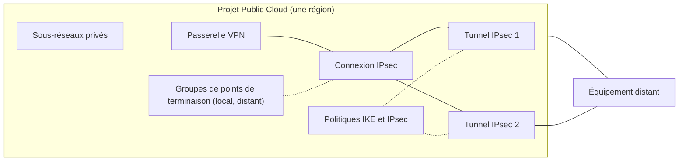

## Objectif

Ce guide vous emmène d'un projet Public Cloud vide à une connexion IPsec configurée : les objets qu'utilise le VPN Site-to-Site, les limites qui s'y appliquent, et les étapes dans la Console pour créer une passerelle VPN, puis une connexion IPsec avec ses groupes de points de terminaison, sa proposition de sécurité et un ou deux tunnels IPsec, et lire les valeurs à régler sur l'équipement distant.

:::warning
Le VPN Site-to-Site est en **alpha**. La Console propose les régions de votre projet où le VPN Site-to-Site est disponible (**BHS1.PREPROD** pendant l'alpha), et le VPN Site-to-Site est gratuit. Les écrans et le comportement peuvent changer avant la disponibilité générale.
:::

**Dans ce guide, vous apprendrez à :**

- Comprendre les objets que crée le VPN Site-to-Site et les limites qui s'y appliquent.
- Ouvrir le VPN Site-to-Site dans un projet Public Cloud.
- Créer une passerelle VPN attachée à vos réseaux privés et au réseau public.
- Créer une connexion IPsec vers un site distant avec la page de création.
- Router vos instances vers la passerelle VPN, pour qu'elles joignent les réseaux distants, et vérifier ce qui a été créé.

## Prérequis

- Un projet Public Cloud dans votre compte OVHcloud.
- Un accès à la <ManagerLink to="/beta/#/public-cloud/project">Console OVHcloud</ManagerLink>.
- Le VPN Site-to-Site activé sur le projet. Sans cela, l'entrée **Site-to-Site VPN** n'apparaît pas dans le menu, et les pages du VPN Site-to-Site redirigent vers le tableau de bord du projet. Pour rejoindre l'alpha, contactez votre interlocuteur OVHcloud.
- Un réseau privé avec au moins un sous-réseau dans une région où le VPN Site-to-Site est disponible (BHS1.PREPROD pendant l'alpha).
- Un équipement distant (un routeur sur site, un pare-feu ou la passerelle VPN d'un autre cloud) avec une adresse IPv4 ou IPv6 publique, que vous pouvez configurer.

## Concepts clés 

Le VPN Site-to-Site relie les réseaux privés de votre projet Public Cloud à un site distant par des tunnels IPsec. L'extrémité OVHcloud des tunnels est une **passerelle VPN** : un routeur dédié à IPsec, attaché à vos sous-réseaux privés d'un côté et au réseau public de l'autre, dans une région fixée à la création. L'extrémité distante est votre propre équipement : un pare-feu ou un routeur sur site, ou le service VPN d'un autre fournisseur cloud.

- **Groupe de points de terminaison** : une liste nommée de CIDR dans une région — les réseaux **locaux** (côté OVHcloud) ou **distants** (ceux du site distant) d'une connexion IPsec. Plusieurs connexions peuvent partager le même.
- **Politique IKE** et **politique IPsec** : les algorithmes de phase 1 et de phase 2 (chiffrement, intégrité, groupe Diffie-Hellman, durée de vie) que négocie un tunnel. Configurez les mêmes algorithmes sur l'équipement distant. Les politiques sont des objets partagés : plusieurs tunnels peuvent utiliser la même paire.
- **Connexion IPsec** : décrit un site distant — la passerelle sur laquelle elle s'exécute, son mode de routage (statique ou BGP) et ses deux groupes de points de terminaison. Ils sont fixés une fois la connexion créée ; seuls son nom et sa description peuvent changer. Une passerelle VPN porte une connexion IPsec.
- **Tunnel IPsec** : porte les réglages propres à chaque tunnel — l'adresse publique du pair, la clé pré-partagée, les politiques IKE et IPsec, la détection de pair mort, la MTU. Une connexion compte jusqu'à deux tunnels ; celui de plus petite **priorité** est préféré, ce qui donne un chemin de secours.
- **Clé pré-partagée (PSK)** : les tunnels s'authentifient uniquement par PSK — l'authentification par certificat n'est pas prise en charge. Elle compte de 8 à 255 caractères ASCII imprimables, est obligatoire à la création et en écriture seule : la Console ne l'affiche plus jamais, gardez-en votre propre copie.
- **Routage** : une connexion est **statique** (les réseaux du groupe distant sont routés dans les tunnels ; la bascule entre deux tunnels est actif/secours, non préemptive) ou **BGP** (une session eBGP par tunnel ; la bascule suit BGP et est préemptive). Dans les deux modes, le trafic vers les réseaux distants est abandonné, jamais envoyé en clair, quand tous les tunnels sont tombés.

### Limites clés 

- Une passerelle VPN porte **une** connexion IPsec, qui compte **jusqu'à deux** tunnels IPsec.
- Les politiques acceptent un ensemble d'options renforcé : IKEv2 uniquement, AES (CBC ou GCM) avec SHA-2 ; les options plus faibles (IKEv1, SHA-1, 3DES, groupes Diffie-Hellman 2 et 5) sont refusées.
- Un réseau distant ne peut pas être une route par défaut (`0.0.0.0/0` ou `::/0`), ni contenir l'adresse du pair d'un tunnel.
- Une connexion BGP porte une seule famille d'adresses : ses réseaux et ses adresses de tunnel sont tous en IPv4, ou tous en IPv6.
- La Console n'indique pas si un tunnel est actuellement établi : le statut affiché est un statut de provisionnement.

## En pratique

Cette section couvre toute la première mise en place, dans l'ordre qu'attend la Console.

**Sommaire :**

- [Étape 1 - Ouvrir le VPN Site-to-Site](#open)
- [Étape 2 - Créer une passerelle VPN](#gateway)
- [Étape 3 - Créer la connexion IPsec](#connection)
- [Étape 4 - Configurer l'équipement distant](#remote)
- [Étape 5 - Router vos instances vers la passerelle VPN](#routes)
- [Étape 6 - Vérifier](#verify)

### Étape 1 - Ouvrir le VPN Site-to-Site 

1. Connectez-vous à la <ManagerLink to="/beta/#/public-cloud/project">Console OVHcloud</ManagerLink> et sélectionnez votre projet Public Cloud.
2. Dans le menu du projet, ouvrez la section **Réseau** et cliquez sur <code className="action">Site-to-Site VPN</code>. L'entrée porte une étiquette **Alpha**.

La page **VPN Site-to-Site** s'ouvre. Dans un projet sans passerelle VPN, la page affiche **Aucune passerelle VPN** à la place des onglets, avec un bouton <code className="action">Créer une passerelle VPN</code>. Une fois une passerelle créée, la page compte cinq onglets : <code className="action">Passerelles VPN</code>, <code className="action">Connexions IPsec</code>, <code className="action">Groupes de points de terminaison</code>, <code className="action">Politiques IKE</code> et <code className="action">Politiques IPsec</code>.

### Étape 2 - Créer une passerelle VPN 

La passerelle VPN est le premier objet à créer : une connexion IPsec s'exécute toujours sur une passerelle VPN.

1. Cliquez sur <code className="action">Créer une passerelle VPN</code>.
2. Dans **Nom**, saisissez un nom (255 caractères au plus). Un nom déjà utilisé par une passerelle VPN du projet est refusé. Un nom par défaut de la forme `vpn-gw-<jjmmaaaa>` est prérempli.
3. Dans **Région**, sélectionnez la région de la passerelle. Une carte s'affiche par région de votre projet où le VPN Site-to-Site est disponible (**BHS1.PREPROD** pendant l'alpha). La région ne peut plus changer une fois la passerelle créée, et ses réseaux privés sont dans cette région.
4. Dans **Configuration réseau**, choisissez un **Réseau privé** et un **Sous-réseau** pour chaque sous-réseau que la passerelle doit desservir. Le premier sous-réseau de la région est présélectionné. Cliquez sur <code className="action">Ajouter un sous-réseau</code> pour ajouter une ligne, ou sur le bouton de suppression d'une ligne pour la retirer. La passerelle prend une IP privée dans chaque sous-réseau, et tout hôte de ces sous-réseaux peut la joindre. Sous les lignes, la page indique la connectivité publique : il n'y a rien à choisir. La passerelle VPN reçoit une adresse IPv4 et une adresse IPv6 publiques, conservées jusqu'à sa suppression, et chaque tunnel IPsec utilise celle de la famille de son pair.
5. Vérifiez le récapitulatif à droite (**Région**, **Réseaux privés**, **IP publique**), puis cliquez sur <code className="action">Créer la passerelle VPN</code>.

La Console confirme que la passerelle est en cours de création : une fois prête, créez sa connexion IPsec depuis sa page. La passerelle ne peut pas porter de tunnel IPsec pendant sa création, ni avant d'avoir une IP publique.

:::tip
Une passerelle créée sans sous-réseau ne transporte aucun trafic tant qu'un sous-réseau n'est pas attaché. Vous pouvez attacher des sous-réseaux plus tard depuis la page de la passerelle, dans sa carte **Réseaux privés**.
:::

### Étape 3 - Créer la connexion IPsec 

La page **Créer une connexion IPsec** crée, en une seule soumission, les groupes de points de terminaison que vous définissez comme nouveaux, les politiques IKE et IPsec si elles sont nécessaires, la connexion IPsec et ses tunnels.

1. Ouvrez l'onglet <code className="action">Connexions IPsec</code> et cliquez sur <code className="action">Créer une connexion IPsec</code>. Vous pouvez aussi ouvrir la page de la passerelle et cliquer sur <code className="action">Créer une connexion IPsec</code> dans sa carte **Connexion IPsec** : la passerelle est alors présélectionnée.
2. Dans **Connexion IPsec**, saisissez un **Nom**. Un nom par défaut de la forme `ipsec-connection-<jjmmaaaa>` est prérempli.
3. Dans **Passerelle VPN**, sélectionnez la passerelle. Seules les passerelles sans connexion IPsec sont listées. Une passerelle qui ne peut pas encore porter de tunnel est listée mais ne peut pas être sélectionnée, avec sa raison : elle est en cours de création et n'a pas encore d'IP publique, en cours de mise à jour, en cours de suppression, non attachée au réseau public, ou sans IP publique.
4. Dans **Routage**, sélectionnez <code className="action">Statique</code> ou <code className="action">BGP</code> :
    - **Statique** : les réseaux distants passent par le tunnel de plus petite priorité ; l'autre prend le relais en cas de panne.
    - **BGP** : une session eBGP par tunnel ; seules les routes comprises dans le groupe distant sont acceptées (jusqu'à 100). Saisissez l'**ASN local** (prérempli avec `65000`) et l'**ASN du pair**, et activez <code className="action">ECMP entrant</code> si l'équipement distant peut répartir son trafic sur les deux tunnels. Les deux ASN doivent être différents, et chacun compris entre 1 et 4294967295, sauf 23456.
5. Dans **Groupes de points de terminaison**, définissez le **Groupe local** (côté OVHcloud) et le **Groupe distant** (les réseaux du site distant). Pour chaque côté, sélectionnez <code className="action">Groupe existant</code> et choisissez un groupe de la région de la passerelle, ou <code className="action">Nouveau groupe</code> et saisissez un **Nom** et ses **CIDR** (<code className="action">Ajouter un CIDR</code> ajoute une ligne). Les deux côtés démarrent sur un nouveau groupe. Un nouveau groupe local est prérempli avec les CIDR des sous-réseaux auxquels la passerelle est attachée. Un réseau distant ne peut pas être une route par défaut (`/0`), et aucun CIDR distant ne peut contenir l'adresse du pair d'un tunnel. Sur une connexion BGP, utilisez uniquement des CIDR IPv4 ou uniquement des CIDR IPv6.
6. Dans **Proposition de sécurité**, sélectionnez les algorithmes que négocient les deux tunnels :
    - La première option, marquée **Recommandée** : IKEv2 · AES-256 · SHA-256 · Groupe 14 (MODP-2048) avec une durée de vie de 10800 secondes pour la phase 1, et ESP · Tunnel · AES-256 · SHA-256 · Groupe 14 (MODP-2048) avec une durée de vie de 3600 secondes pour la phase 2. Si la région de la passerelle a déjà une politique IKE et une politique IPsec avec exactement ces algorithmes, les tunnels les utilisent. Sinon, `ike-aes256-sha256` et `ipsec-aes256-sha256` sont créées avec la connexion. L'équipement distant n'a pas besoin de reprendre cette durée de vie : chaque côté renégocie les clés selon son propre minuteur.
    - <code className="action">Politiques existantes</code> : choisissez une **politique IKE** et une **politique IPsec** de la région de la passerelle, pour un équipement distant qui a ses propres algorithmes. Cette option est désactivée tant que la région n'a aucune politique IKE et IPsec. Pour utiliser d'autres algorithmes ou une autre durée de vie, créez d'abord les politiques depuis les onglets <code className="action">Politiques IKE</code> et <code className="action">Politiques IPsec</code>.
7. Dans **Tunnels IPsec**, sélectionnez <code className="action">Deux (recommandé)</code> ou <code className="action">Un</code>, puis remplissez chaque bloc **Tunnel IPsec** :
    - **Nom** : prérempli avec le nom par défaut de la connexion suivi de `-1` et `-2` (par exemple `ipsec-connection-10112026-1`). Ces noms ne suivent pas le nom de connexion que vous saisissez : changez-les ici si vous voulez qu'ils correspondent.
    - **Adresse du pair** : l'adresse IPv4 ou IPv6 publique de l'équipement distant pour ce tunnel.
    - **Priorité** : préremplie avec 1 et 2. La plus petite est préférée.
    - **Clé pré-partagée** : de 8 à 255 caractères ASCII imprimables. Elle est en écriture seule : la Console ne l'affiche plus jamais, gardez-en votre propre copie.
    - Sur une connexion BGP, **Adresse de tunnel BGP** et **Adresse du pair BGP** : quand vous sélectionnez BGP, les champs vides sont préremplis avec des réseaux `/30` libres de `169.254.0.0/16` (`169.254.10.1/30` et `169.254.10.2`, puis `169.254.10.5/30` et `169.254.10.6`, quand rien d'autre ne les utilise). L'équipement distant doit utiliser les mêmes adresses.
8. Vérifiez le récapitulatif à droite, puis cliquez sur <code className="action">Créer la connexion IPsec</code>. Le bouton reste désactivé tant que chaque étape n'est pas valide.

L'ID du pair, l'ID local, la détection de pair mort, la MTU et l'initiateur prennent leurs valeurs par défaut. Vous pouvez les modifier ensuite depuis la page de chaque tunnel.

Si la soumission échoue en cours de route, une notification d'erreur **Impossible de créer la connexion IPsec** indique l'étape en échec, la raison donnée par l'API et ce qui a déjà été créé et conservé. La page reste ouverte avec ce que vous avez saisi, pour corriger et soumettre à nouveau.

### Étape 4 - Configurer l'équipement distant 

Une fois la connexion soumise, la page devient un récapitulatif. Elle affiche une carte **Router les réseaux distants** (voir l'[étape 5](#routes)), puis une carte par tunnel : **Pair distant (notre IP publique)**, **Leurs réseaux**, **Nos réseaux**, **IKE (phase 1)**, **IPsec (phase 2)** et, sur une connexion BGP, **BGP**.

1. Configurez ces valeurs sur l'équipement distant, avec la clé pré-partagée que vous avez saisie pour chaque tunnel. La clé pré-partagée est en écriture seule : l'API ne la renvoie jamais.
2. Ajoutez les routes d'hôte, comme décrit à l'[étape 5](#routes), avant de quitter le récapitulatif.
3. Cliquez sur <code className="action">Terminer</code>.

Pour relire ces valeurs plus tard, ouvrez la page de la connexion et cliquez sur <code className="action">Copier la configuration de l'équipement distant</code> sur un tunnel. Pour les réglages qu'attend chaque fournisseur, consultez les guides de la section [Aller plus loin](#go-further).

### Étape 5 - Router vos instances vers la passerelle VPN 

Vos instances joignent les réseaux distants par la passerelle VPN une fois que leur sous-réseau les y route : chaque sous-réseau de la passerelle a besoin d'une **route d'hôte** par réseau distant, dont le prochain saut est l'IP privée de la passerelle sur ce sous-réseau. Le DHCP du sous-réseau transmet ces routes à toutes les instances du sous-réseau.

1. Sur le récapitulatif de la nouvelle connexion, lisez la carte **Router les réseaux distants**. Elle liste, pour chaque sous-réseau de la passerelle, la route dont ses instances ont besoin : `<sous-réseau> (<cidr>)` · `<réseau distant> → <IP privée de la passerelle sur ce sous-réseau>`, une par réseau distant de la famille d'adresses de la connexion. Un sous-réseau dont l'IP privée n'est pas encore connue est omis.
2. Cliquez sur <code className="action">Ajouter les routes</code>. Les routes sont ajoutées après les routes d'hôte existantes de chaque sous-réseau. Une destination qu'un sous-réseau route déjà, par cette passerelle ou ailleurs, est laissée telle quelle, jamais écrasée. Une notification indique combien de routes ont été ajoutées, et le bouton affiche ensuite **Routes ajoutées**.
3. Appliquez les routes sur les instances, comme décrit ci-dessous.

Vous pouvez aussi ajouter ou modifier les routes d'un sous-réseau plus tard : ouvrez la page de la passerelle et, dans la carte **Réseaux privés**, cliquez sur <code className="action">Routes d'hôte</code> sur la ligne du sous-réseau. La page du sous-réseau s'ouvre avec son panneau **Ajouter une route**, l'IP privée de la passerelle préremplie comme **Prochain saut** : saisissez le réseau distant comme **Destination**, puis cliquez sur <code className="action">Ajouter une route</code>. Les routes d'un sous-réseau sont listées, ajoutées et supprimées sur sa page.

:::warning
Les instances prennent en compte les nouvelles routes d'hôte au prochain renouvellement de leur bail DHCP, qui peut prendre plusieurs heures, ou à leur redémarrage. D'ici là, elles n'envoient pas de trafic vers les réseaux distants par la passerelle VPN.
:::

Pour appliquer les routes tout de suite, redémarrez les instances, ou renouvelez leur bail DHCP depuis chaque instance. Sur une image Linux qui utilise systemd-networkd, comme Debian ou Ubuntu, exécutez `sudo networkctl renew <interface>`. La route apparaît alors dans `ip route`, par exemple `10.42.0.0/16 via 10.1.0.221 dev ens3 proto dhcp`.

### Étape 6 - Vérifier 

Vérifiez les objets dans la Console.

| Vérification | Où | Résultat attendu |
|---|---|---|
| La passerelle a son adresse publique | Page de la passerelle, carte **Réseau public** | **IPv4 publique** (et **IPv6 publique**) affichent une adresse |
| La passerelle est sur ses sous-réseaux | Page de la passerelle, carte **Réseaux privés** | Une ligne par sous-réseau, avec son **IP privée** |
| La connexion existe | Onglet <code className="action">Connexions IPsec</code> | Une ligne, avec sa **Passerelle VPN**, son **Routage** et son nombre de **Tunnels IPsec** |
| Les tunnels existent | Page de la connexion, section **Tunnels IPsec** | Une tuile par tunnel, triée par priorité |
| Le sous-réseau route les réseaux distants | Page du sous-réseau, carte **Routes d'hôte** | Une ligne par réseau distant, avec l'IP privée de la passerelle comme **Prochain saut** |
| Une instance a la route | Sur l'instance, `ip route` | Une ligne par réseau distant, `via` l'IP privée de la passerelle |

:::info
La Console n'affiche pas l'état des tunnels : elle n'indique pas si un tunnel est établi. Vérifiez le tunnel sur l'équipement distant, puis envoyez du trafic entre une instance et un hôte du réseau distant, par exemple avec `ping`.
:::

## Aller plus loin 

- [VPN Site-to-Site - Se connecter à AWS](/guides/public-cloud/network-services/site-to-site-vpn-connect-aws)
- [Créer un réseau privé avec une Gateway](/guides/public-cloud/network-services/create-private-network-gateway)
- [Mettre à jour les propriétés d'un sous-réseau](/guides/public-cloud/network-services/update-subnet-properties)

Échangez avec notre [communauté d'utilisateurs](/links/community).
